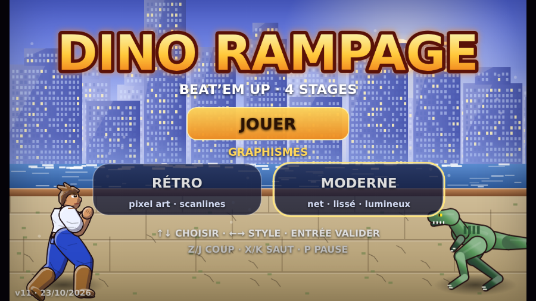
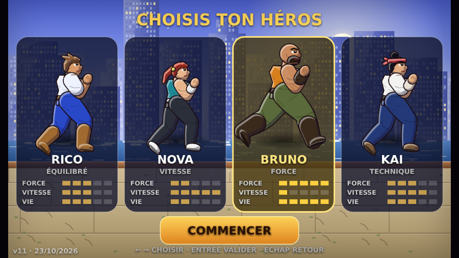
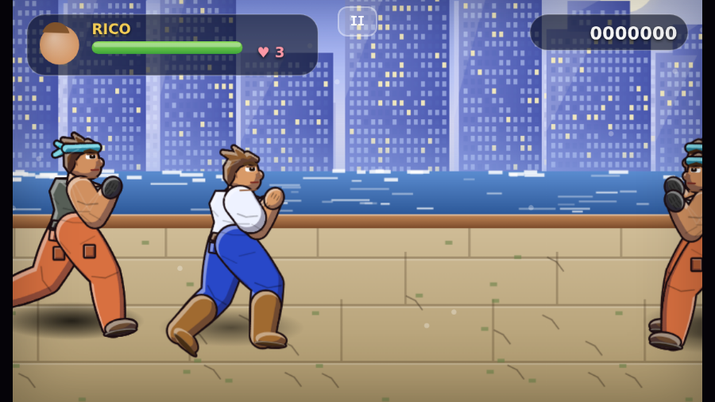
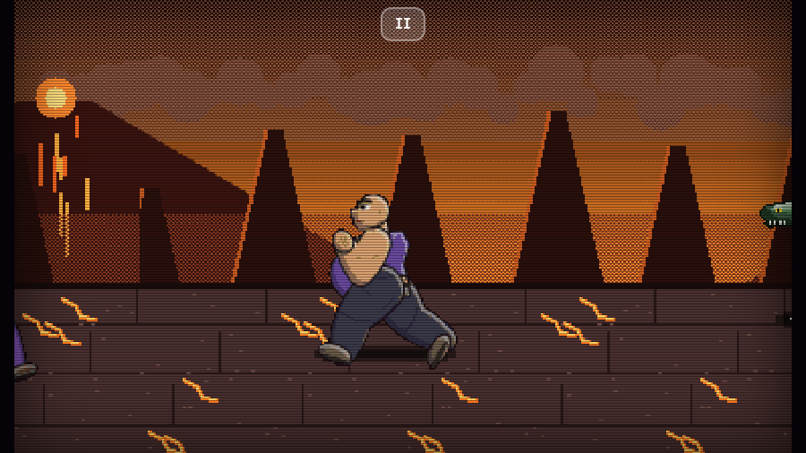

# 🦖 Dino Rampage

Beat'em up d'arcade en **HTML5 / JavaScript pur** (un seul fichier, aucune dépendance), jouable au clavier sur ordinateur et au tactile sur smartphone.
4 stages, 4 héros, un boss par stage, deux styles graphiques au choix.

> **Jouer en ligne** :  https://byjpe.github.io/Dinorampage/

| Menu (moderne) | Choix du héros |
|---|---|
|  |  |
| **Jeu (moderne, caméra rapprochée)** | **Boss du dernier stage (rétro)** |
|  |  |

## Fonctionnalités

- **4 stages** : front de mer, jungle, marais, volcan. Chacun a son décor à 3 plans de parallaxe, sa musique, ses vagues d'ennemis et un boss.
- **4 héros originaux** avec statistiques et enchaînements différents :

| Héros | Style | Combo |
|---|---|---|
| Rico | Équilibré | jab, direct, crochet, uppercut |
| Nova | Rapide, moins de dégâts | jab, coups de pied, coup de pied haut |
| Bruno | Lent, très solide et puissant | crochets lourds, uppercut |
| Kai | Technique | jab, direct, coup de pied, coup de pied haut |

- **Mouvements** : marche, course (+ coup lancé), saut, coup sauté, projections, chutes et relevés.
- **Ennemis** : voyous, brutes, raptors, T-Rex ; coups variés avec phase de préparation lisible.
- **Deux styles graphiques**, changeables depuis le menu ou la pause (choix mémorisé) :
  - **Rétro** : pixel art 384×224, scanlines.
  - **Moderne** : rendu vectoriel ×3, lissé, caméra rapprochée, interface en verre dépoli.
- **Bonus** : cuisse de poulet (soin), pièces d'or (score).
- **Audio** entièrement synthétisé (Web Audio) : musique rock, bruitages, cri de mort.
- **Pause** (P / Échap, bouton « II » en tactile), pause automatique si l'onglet passe en arrière-plan.

## Commandes

| Action | Clavier | Tactile |
|---|---|---|
| Déplacement | Flèches ou WASD | croix directionnelle |
| Coup | Z ou J | bouton COUP |
| Saut | X ou K | bouton SAUT |
| Pause | P ou Échap | bouton II |
| Menus | Flèches + Entrée | tap |

Astuces : maintenir une direction fait courir le héros ; COUP pendant la course lance un coup en avançant.

```
## Structure

```
index.html                 # le jeu complet (HTML + CSS + JS)
docs/                      # captures d'écran du README
tests/smoke_test.py        # test de fumée Playwright
.github/workflows/pages.yml
```

Dans `index.html`, le moteur de sprites construit chaque personnage à partir d'une ossature (capsules articulées), avec ombrage et contours automatiques en rétro, et rendu vectoriel dégradé en moderne. Les poses sont décrites par des angles d'articulation.

## Mentions

**Œuvre originale** inspirée du genre beat'em up d'arcade des années 90. Elle n'est affiliée à aucun éditeur. Aucune ROM, aucun sprite, aucun son et aucun code de jeu commercial n'est inclus : les graphismes sont générés par le code et l'audio est synthétisé.

Si tu ajoutes des ressources externes (sprites, sons), vérifie que tu en détiens les droits.

## Licence

[MIT](LICENSE) pour le code.
